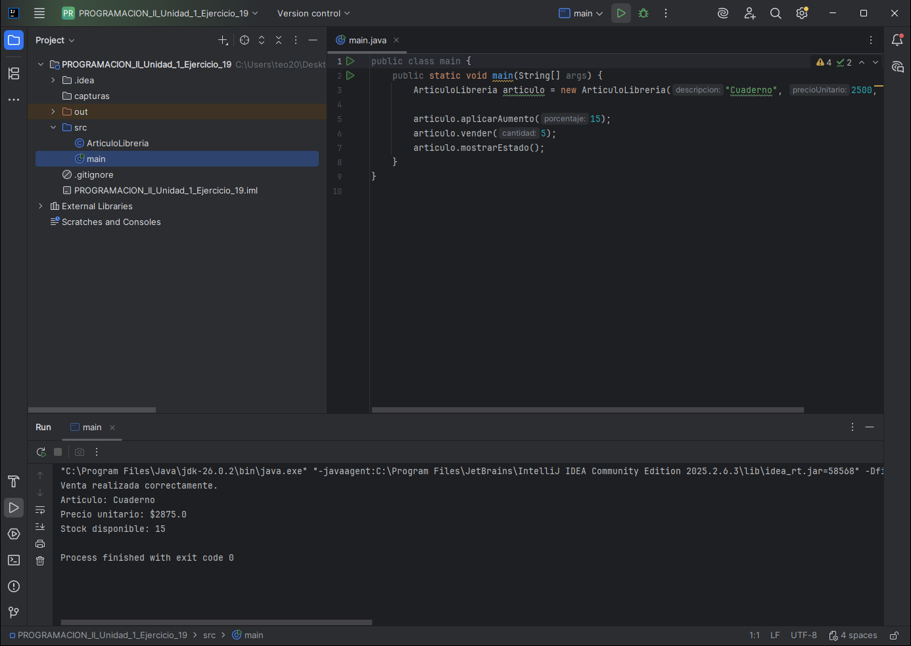

# PROGRAMACIÓN II — Unidad 1, Ejercicio 19: Control de Inventario de Librería Escolar

Trabajo práctico de Programación II. Este repositorio contiene la resolución en Java del ejercicio 19 de la Unidad 1.

## Consigna

#### Contexto

Las librerías escolares manejan artículos de papelería y útiles cuyos precios y existencias deben actualizarse constantemente ante la demanda de los estudiantes.

#### Consigna

Desarrollar una clase en Java que represente un artículo de librería con control de precio unitario y unidades disponibles.

#### Desarrollo requerido

- Definir la clase ArticuloLibreria con atributos descripcion (String), precioUnitario (double) y stock (int).
- Incorporar un constructor parametrizado y métodos de validación para impedir precios o stocks negativos.
- Implementar un método aplicarAumento(double porcentaje) que incremente el precio unitario en función de un porcentaje dado, y un método vender(int cantidad).
- En el método main, instanciar un artículo, aplicarle un incremento porcentual por inflación, realizar una venta y mostrar el balance final en consola.

## Estructura del repositorio

```
PROGRAMACION_II_Unidad_1_Ejercicio_19/
├── README.md
├── capturas/
│   └── consola.png
└── src/
    ├── ArticuloLibreria.java
    └── main.java   # clase con el método main
```

## Funcionamiento y lógica

### `ArticuloLibreria`

Representa un artículo de librería con los atributos privados `descripcion`, `precioUnitario` y `stock`.

- **Constructor:** no acepta precio ni stock negativos; en ese caso los carga en 0 y lo informa.
- **`aplicarAumento(double porcentaje)`:** sube el precio en el porcentaje indicado (`precio + precio * porcentaje / 100`); rechaza porcentajes negativos.
- **`vender(int cantidad)`:** descuenta del stock solo si la cantidad es positiva y hay unidades suficientes, e informa si la venta se pudo hacer.
- **`mostrarEstado()`:** imprime la descripción, el precio unitario y el stock disponible.

### `main`

Crea un **Cuaderno** a $2500 con 20 unidades, le aplica un aumento del 15 % (pasa a **$2875**), vende 5 unidades (quedan **15**) y muestra el estado final.

## Ejecución

Captura de la consola de IntelliJ IDEA ejecutando el programa:



Salida obtenida:

```
Venta realizada correctamente.
Articulo: Cuaderno
Precio unitario: $2875.0
Stock disponible: 15
```
